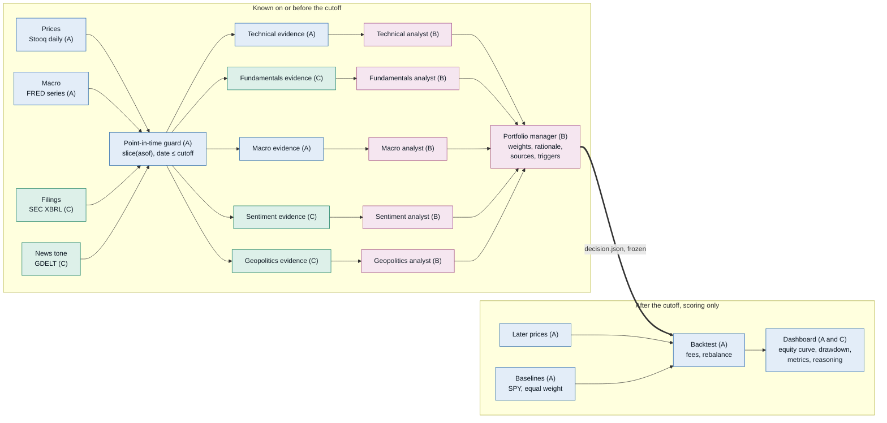
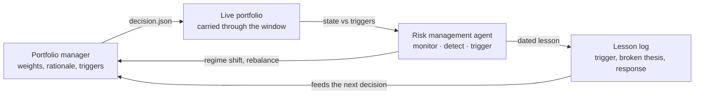

# aws-financial-portfolio

Team build plan for Track 3 (Financial Portfolio Management) at the Austin Agentic AI Hackathon, Oct 23, 2026. Five analyst agents and a portfolio manager build a portfolio using only data dated on or before a cutoff. A backtest then scores it against what the market did next.

> Historical experiment, not financial advice or a trading recommendation.

- **Team:** three people, roles A, B and C below. Put your GitHub handle next to your role.
- **Model:** a Bedrock inference profile from the starter kit, default `us.openai.gpt-5.6-luna`, region `us-east-1`.
- **Timeline:** 4 hours, finishing at 4:00 pm. T+0:00 is the start. Drop the stretch items first when time runs short.
- **Checkpoints:** at the end of each phase everyone stops, runs `git pull --rebase`, commits and pushes, then checks the milestone before moving on.

[Get started](#get-started) · [What to aim for](#what-to-aim-for) · [Lock first](#lock-these-in-the-first-30-minutes) · [Pipeline](#how-the-pieces-connect) · [Risk management](#risk-management) · [Roles](#who-does-what) · [Timeline](#timeline) · [Contracts](#contracts-and-layout) · [Look-ahead checklist](#look-ahead-checklist) · [Risks](#risks-and-fallbacks) · [Demo](#three-minute-demo) · [Results](#results-and-limitations)

## Milestones

Tick these off by editing this file.

- [ ] **M0 · T+0:20.** Config and schemas committed. Three go or no-go answers reported.
- [ ] **M1 · T+1:15.** One command runs end to end on technical evidence alone. This is your fallback demo.
- [ ] **M2 · T+2:15.** All five analysts run on real evidence. The manager's output carries rationale, sources and triggers.
- [ ] **M3 · T+3:15.** Config, prompts and data are frozen. The final window is run once and cached.
- [ ] **M4 · T+3:30.** Code freeze. Nothing merges after this.

## Get started

Everyone does this once, in the workshop terminal where the AWS credentials are set. CLI credentials last 60 minutes, so refresh them if calls start failing.

```bash
git clone https://github.com/arnavvalvekar/aws-financial-portfolio.git
cd aws-financial-portfolio/hackathon-kit
export AWS_REGION=us-east-1
aws sts get-caller-identity
python3 -m venv .venv
.venv/bin/pip install -r requirements.txt
.venv/bin/python infer.py
```

The last command should print `OK`. The kit's own [README](hackathon-kit/README.md) has the model table, the AgentCore deploy steps and troubleshooting. Leave `hackathon-kit/` untouched and copy from it. `positron.py` is the optional Positron bootstrap from the event page, and the core build does not need it.

## What to aim for

The demo checklist asks for three things. State the universe, cutoff and baseline. Show the reasoning behind at least one allocation. Compare the equity curve and key metrics with the baseline. A few months of returns on ten stocks is mostly noise, so the return figure will not carry the demo. A traceable thesis and a clean test will.

Three rules:

1. **No peeking.** Nothing dated after the cutoff reaches an agent. One function, `pit.slice(asof)`, is the only way to read data, and a test fails if any date runs past the cutoff.
2. **Show the sources.** Every claim cites an evidence ID. The portfolio manager returns weights with analyst weighting, conflicts, and the triggers that would change the position. A validator rejects any ID that is not in the evidence pack.
3. **Score once.** Tune prompts on an earlier development cutoff, freeze them, then run the final window one time. Report both baselines even when the portfolio loses to them.

> [!WARNING]
> **The model may remember the window.** A Bedrock model trained past your cutoff can recall how the period played out, and that is look-ahead too. Check the training cutoff of the profile you pick (the kit lists five) and prefer a cutoff after it, even if the test window gets shorter. If you cannot, say so in the limitations. Choosing the universe has the same trap. Pick it with a rule written before you look at returns, such as the largest company in each sector at the cutoff.

## Lock these in the first 30 minutes

Put the answers in `config.yaml` and commit it. Every other task depends on them. The middle column holds proposals. Write the team's decision in the last one.

| Decision | Proposal | Decided |
| --- | --- | --- |
| Organizer rules | Ask whether the universe, cutoff or evaluation window is fixed. The brief says portfolios are evaluated against actual performance, and it also asks you to choose a cutoff. | |
| Model | The kit offers five Bedrock inference profiles: `us.openai.gpt-5.4`, `us.openai.gpt-5.5`, `us.openai.gpt-5.6-luna` (the default), `us.openai.gpt-5.6-sol` and `us.openai.gpt-5.6-terra`. Use one profile in `us-east-1` at temperature 0, and cache every request to disk by hash. Temperature 0 does not guarantee identical text, so the cache is what makes a re-run reproducible. | |
| Cutoff and window | One quarter-end trading day and a fixed end date. Example: cutoff `2026-06-30`, end `2026-10-16`. Choose the model first. A cutoff after the model's training data avoids memory leaks but leaves a shorter window. An earlier cutoff gives a longer window and needs a disclosure. | |
| Universe | Ten S&P 500 stocks across at least seven sectors, chosen by a written rule. Example: `AAPL MSFT NVDA AMZN XOM JNJ PG CAT NEE KO`. Use domestic 10-K and 10-Q filers only. Leave banks out of version 1, because their revenue tags differ. | |
| Baselines | SPY buy-and-hold, and equal weight across the same universe. The second one separates a good universe from good weighting. | |
| Decision rule | Version 1: the agents decide once at the cutoff and the portfolio is held to the end date. Version 2 (stretch): re-run at each month-end using only data up to that date. Long only, 25% cap per name, up to 20% cash, 5 bps cost on traded value. | |
| Returns | The same adjusted price series for the portfolio and both baselines. State whether dividends are included. Risk-free rate is zero or the FRED 3-month bill rate. Pick one and print it. | |
| Metrics | Total return, CAGR, volatility, Sharpe, maximum drawdown with its dates, excess return against each baseline, and contribution by position. | |

## How the pieces connect



The cutoff works as a one-way valve. Agents read only evidence packs built through the point-in-time guard. The one thing that crosses is `decision.json`, frozen before any later price is loaded. Later prices come from the same price store and are read by the backtest alone. The dashboard also reads `decision.json` and the analyst reports for its reasoning view. The letters show who builds each piece.

## Risk management

A risk management agent sits on top of the portfolio manager and closes the loop. In the backtest it stands in for the live risk desk, so "live portfolio" means the positions as they are carried forward through the scored window. Keep it inside the same point-in-time discipline: it reads only data dated on or before the step it is acting on, and a leakage test covers it like every other agent.

It does three things.

1. **Monitors the live portfolio.** At each step it tracks the state the positions actually reach: drawdown, realised volatility, exposure by sector and name, and how far each weight has drifted from the frozen target. It compares that state against the `change_triggers` the portfolio manager already wrote per position, so a watch is only ever against a threshold the manager committed to beforehand.
2. **Detects regime shifts.** It watches for the conditions that break the thesis, such as a rate-hike surprise from the FRED macro evidence, a geopolitical shock from the GDELT and event feeds, a volatility spike, or a trend break through the 200-day average. A shift is flagged only when the evidence crossing the line is dated on or before the current step, with its evidence ID, so the call is auditable.
3. **Triggers rebalancing.** When a regime shift fires, it hands control back to the portfolio manager for a fresh decision at that step's cutoff, under the same constraints (long only, 25% cap per name, up to 20% cash, costs on traded value). This is the version 2 month-end path with an event-driven trigger on top, so in version 1 the agent still runs and reports, it just records the trigger rather than acting on it.

The loop closes back to the portfolio manager. Each flagged shift and the rebalance it caused is logged as a dated lesson: which trigger fired, which thesis it broke, and what the manager changed in response. That log feeds back into the manager's next decision so the following portfolio avoids repeating the same mistake. Over a run this turns one-shot allocation into a system that learns from what the market did to it, within the point-in-time rules.



Risk and limitations: an event-driven rebalance adds trades and cost, so count every rebalance against the 5 bps cost on traded value and report how many fired. The feedback log must stay point-in-time, a lesson can only use evidence dated on or before the step that produced it, or it becomes look-ahead. In version 1 keep the agent in report-only mode so the scored result stays a single frozen decision; promote it to acting only once the month-end path is in.

Owner: B, alongside the portfolio manager and orchestration, with A wiring the monitored state out of the backtest.

## Who does what

The split is by layer, so each person owns different directories and rarely edits the same file. Agree the contracts below first. After that everyone can build against fixtures before real data arrives.

### A · Data and backtest

Owns the numbers. Owner: _add your GitHub handle_. Best fit: pandas and some finance math.

- **Owns:** `src/pit.py`, `src/data/prices.py`, `src/data/macro.py`, `src/evidence/technical.py`, `src/evidence/macro.py`, `src/backtest/`, `app/`, `tests/`
- **Done when:** one command prints return, volatility, Sharpe and maximum drawdown for the portfolio, SPY and equal weight, and the leakage test passes.

### B · Agents and orchestration

Owns the reasoning. Owner: _add your GitHub handle_. Best fit: prompts and the AWS SDK.

- **Owns:** `src/agents/`, `agentcore/`, `SCHEMAS.md`, `prompts/`
- **Done when:** `python run.py --config config.yaml` writes `decision.json` from real evidence, and a second run returns the identical file from cache.

### C · Evidence and story

Owns the hard data and the pitch. Owner: _add your GitHub handle_. Best fit: patience with messy data, and a good voice for the demo.

- **Owns:** `src/data/sec.py`, `src/data/gdelt.py`, `src/evidence/fundamentals.py`, `src/evidence/sentiment.py`, `src/evidence/geo.py`, the [Results and limitations](#results-and-limitations) section, and the demo script.
- **Done when:** fundamentals, sentiment and geopolitics packs exist for every ticker with a printed data horizon, and a fresh clone reproduces the final run.

### Working agreements

- One owner per directory. Ask before editing someone else's files.
- Commit small and push at least hourly. Keep `main` runnable.
- Commit derived files such as CSVs and evidence packs. Ignore raw downloads and never commit credentials.
- Hold a ten-minute sync at each milestone.

## Timeline

Times count from the start of build time. Tasks are listed per person so you can tick them off. Items marked stretch go first when time runs short.

### Phase 0 · Align (T+0:00 to 0:20, everyone)

- [ ] Make sure all three of you can push to this repo, and have everyone clone it.
- [ ] Everyone runs the kit's `infer.py` from `hackathon-kit/` (see [Get started](#get-started)).
- [ ] Add a `.gitignore` for `.venv/` and raw downloads.
- [ ] Agree `config.yaml` and the two schemas in `SCHEMAS.md`.
- [ ] Ask the organizers what is fixed.

**A**
- [ ] Can Stooq and FRED files be pulled from this network? Commit the price store layout.

**B**
- [ ] Which of the kit's five GPT profiles work in this account?
- [ ] Does a forced tool call return clean JSON on the one you pick? If not, ask for JSON only and lean on the validator.
- [ ] Write `SCHEMAS.md`.

**C**
- [ ] Can an SEC quarterly zip be downloaded with a User-Agent header, and is GDELT reachable?
- [ ] Map tickers to CIKs.

> **M0 · T+0:20.** Config and schemas committed. Three go or no-go answers reported.

### Phase 1 · Walking skeleton (T+0:20 to 1:15)

**A**
- [ ] Price store for the universe and SPY, committed as small CSVs.
- [ ] `pit.slice(asof)` and the test that fails on any later date.
- [ ] Technical evidence: momentum, volatility, drawdown, 50 and 200-day trend.
- [ ] Backtest engine with both baselines and metrics.

**B**
- [ ] Converse wrapper grown from the kit's `infer.py`: JSON output, a disk cache, retry with backoff, and a `maxTokens` far above the kit's 128 with a `stopReason` check.
- [ ] Technical analyst and portfolio manager prompts, run on fixture evidence.
- [ ] Validator: weights sum to 1, caps hold, tickers are in the universe. One re-prompt, then a deterministic repair.
- [ ] Orchestrator: analysts in parallel, then the manager, with every input and output saved under `runs/<run_id>/`. It writes `decision.json`.

**C**
- [ ] SEC extraction for three tickers first, then all ten: ticker to CIK, quarterly zips up to the cutoff, only filings with a `filed` date on or before it, about ten tags with two or three candidate names each.
- [ ] First fundamentals CSV with filing dates.
- [ ] Evidence ID format for filings.

> **M1 · T+1:15.** One command runs end to end on technical evidence alone: `decision.json`, equity curve, and metrics against SPY and equal weight. This is your fallback demo.

### Phase 2 · Add the signals (T+1:15 to 2:15)

**A**
- [ ] FRED macro evidence with release lags.
- [ ] Dashboard shell: header strip, equity curve, metrics table.

**B**
- [ ] Fundamentals, macro, sentiment and geopolitics analyst prompts.
- [ ] Portfolio manager version 2: conflicts, analyst weighting, triggers.
- [ ] Citation check: every cited ID must exist in the evidence pack.
- [ ] Parallel analyst calls.

**C**
- [ ] Fundamentals evidence for all tickers: growth, margins, leverage and return on equity, each with an ID.
- [ ] GDELT sample for the 90 days before the cutoff (tone and event counts by theme) into sentiment and geopolitics evidence. Time-box it to 45 minutes.
- [ ] Fallback if GDELT stalls: a dated event log where every row has a source published before the cutoff.
- [ ] A data horizon line on every evidence pack.

> **M2 · T+2:15.** All five analysts run on real evidence. The manager's output carries rationale, sources and triggers.

### Phase 3 · Inspectable and credible (T+2:15 to 3:15)

**A**
- [ ] Leakage test wired into every run.
- [ ] Contribution by position.
- [ ] Reasoning view: stances, conflicts, sources, triggers.
- [ ] Stretch: analyst scorecard.

**B**
- [ ] Prompt tuning on the development cutoff only.
- [ ] Stretch: a risk management agent (see [Risk management](#risk-management)) that monitors the portfolio, detects regime shifts, triggers rebalancing, and feeds what it learns back to the portfolio manager. Build the plain-code checks first (position and cash caps, sector concentration, missing evidence IDs), then the LLM review. Keep it in report-only mode so the scored decision stays frozen.
- [ ] Freeze prompts and config at M3.

**C**
- [ ] Fill in [Results and limitations](#results-and-limitations).
- [ ] Set the rule for the deep-dive position, such as the largest analyst disagreement.
- [ ] Help A with the reasoning view.
- [ ] Fresh-clone test: clone, run one command, get the same `decision.json` and metrics.

> **M3 · T+3:15.** Freeze config, prompts and data. Run the final window once and cache it.

### Phase 4 · Demo (T+3:15 to 4:00, everyone)

- [ ] **B:** AgentCore handler adapted from the kit's `agent.py` into `agentcore/`, deployed with the kit's direct-code-deploy commands. If it fails, demo the local runner and the kit's deployed sample.
- [ ] Rehearse twice against the checklist.
- [ ] Load the cached run so the demo makes at most one live call.
- [ ] Remove the AgentCore runtime and its dedicated role, following the kit's README.
- [ ] **A** speaks to results: curve, metrics, contribution. **B** speaks to reasoning: one decision opened up. **C** opens and closes with framing, credibility and limitations, and keeps the clock.

> **M4 · T+3:30.** Code freeze. Nothing merges after this.

## Contracts and layout

Agree these before anyone codes. They let B build agents against fixtures while A and C produce the real evidence. All values are placeholders.

**`config.yaml`**

```yaml
asof: 2026-06-30       # agents see data dated on or before this day
end: 2026-10-16        # last day scored
universe: [AAPL, MSFT, NVDA, AMZN, XOM, JNJ, PG, CAT, NEE, KO]
baselines: [SPY, equal_weight]
constraints:
  long_only: true
  max_weight: 0.25
  max_cash: 0.20
rebalance: none        # version 2: month_end
costs_bps: 5
region: us-east-1
model: us.openai.gpt-5.6-luna   # kit default. One profile, temperature 0, cached
```

**Evidence IDs.** Every analyst claim lists the IDs it rests on. The validator rejects an ID that is not in that analyst's pack. A hand-built event row needs both a source and a date before the cutoff.

```text
px:<TICKER>:<date>
sec:<TICKER>:<form>:<period-end>:<tag>
fred:<SERIES>:<date>
gdelt:<theme>:<date>
event:<id>

# example
sec:CAT:10-Q:2026-03-31:OperatingIncomeLoss
```

**Analyst view, one per analyst.** Stance runs from -1 (underweight) to +1 (overweight). Confidence runs from 0 to 1.

```json
{
  "analyst": "fundamentals",
  "asof": "2026-06-30",
  "views": [{
    "ticker": "CAT",
    "stance": 0.4,
    "confidence": 0.7,
    "thesis": "One or two sentences grounded in the cited evidence.",
    "evidence": ["sec:CAT:10-Q:2026-03-31:OperatingIncomeLoss"],
    "change_triggers": ["What would flip or weaken this view"]
  }]
}
```

**Portfolio manager decision (abridged).** Weights must sum to 1 across every universe ticker plus `CASH`.

```json
{
  "asof": "2026-06-30",
  "weights": { "CAT": 0.12, "KO": 0.08, "CASH": 0.05 },
  "positions": {
    "CAT": {
      "rationale": "Why this weight, reconciling the analysts.",
      "analyst_weighting": { "technical": 0.3, "fundamentals": 0.4,
        "macro": 0.1, "sentiment": 0.1, "geopolitics": 0.1 },
      "conflicts": ["Technical bullish, fundamentals neutral"],
      "sources": ["px:CAT:2026-06-30"],
      "confidence": 0.6,
      "change_triggers": ["Close below the 200-day average"]
    }
  },
  "portfolio_thesis": "One paragraph.",
  "regime_view": "Macro stance in a sentence or two."
}
```

**Repo layout.** Letters show the owner.

```text
hackathon-kit/            starter kit as committed. Leave it untouched and copy from it
positron.py               optional Positron bootstrap, not needed for the core build
config.yaml  SCHEMAS.md  README.md (this file)
src/
  pit.py                  A   the only door to data
  data/                   A prices, macro      C sec, gdelt
  evidence/               A technical, macro   C fundamentals, sentiment, geo
  agents/                 B llm, analysts, pm, validate, orchestrate
  backtest/               A engine, metrics, attribution
app/                      A dashboard
agentcore/                B handler adapted from the kit's agent.py, plus deploy notes
runs/<run_id>/            evidence, analyst reports, decision.json, equity.csv, metrics.json
tests/                    A test_no_lookahead.py
```

## Look-ahead checklist

Run down this list before the final run. Each item is something a skeptical judge could ask about.

- [ ] **Prices.** Agents get rows dated on or before the cutoff. The backtest reads later rows and nothing else.
- [ ] **SEC filings.** Gate on the `filed` date, not the period end. Use the latest filing for each period as of the cutoff and ignore later amendments.
- [ ] **FRED.** Daily series stop at the cutoff. Lag monthly series by one month and GDP by two, which is safe against real release dates. Revisions after the cutoff are a known gap, so say so.
- [ ] **News and events.** Filter on publication date. Every row in a hand-built event log needs a source dated before the cutoff.
- [ ] **Prompts.** Tell each analyst to use only its evidence pack and to cite IDs. Scan every output for dates after the cutoff and fail the run if one appears.
- [ ] **Model memory.** Compare the model's training cutoff with yours, and state the result in the limitations.
- [ ] **Tuning.** Iterate on a development cutoff. Freeze config, prompts and data, then run the final window once.
- [ ] **Universe.** Pick it with a rule fixed before you look at returns.

## Risks and fallbacks

| Risk | What to do | Owner |
| --- | --- | --- |
| A data source is blocked or slow from the workshop network | Test every source in the first 30 minutes. If Stooq fails, use the Kaggle price datasets. They cover older periods only, so the cutoff has to move into their range. Shrink the universe before you shrink the window. | A, C |
| SEC tags differ between companies | Map two or three candidate tags per metric. Let the fundamentals analyst answer "insufficient data" instead of guessing. | C |
| GDELT is too heavy for a historical window | Sample a few files per week for the 90 days before the cutoff, or switch to the dated event log. Say which one you used. | C |
| Throttling or expired credentials | Cache every model call and limit parallel calls. CLI credentials last 60 minutes, so refresh them when calls start failing. Keep a cached final run ready for the demo. | B |
| The model returns invalid JSON or bad weights | Ask for structured output with a forced tool call if the GPT profile supports it, otherwise ask for JSON only. Validate, re-prompt once, then repair deterministically. Check `stopReason` for truncated output. | B |
| AgentCore deploy limits | The kit uses direct code deploy. Deploy its sample in the first hour, then confirm early that a multi-file package imports correctly. Keep the runtime's `requirements.txt` small and leave data-prep libraries out. Build evidence packs outside the runtime and ship them as files. If the full deploy fails, demo the local runner and show the deployed sample. | B |
| Three separate environments | If each of you has your own workshop account, share code through GitHub and not through `/workshop`. If you share one account, give each person a unique `AGENTCORE_ROLE_NAME` and runtime name, because a second role with the same name fails with `EntityAlreadyExists`. Commit small derived files, not raw zips. One owner per directory. | A, B, C |
| Integration is left to the end | Reach the walking skeleton by T+1:15. Merge to `main` at least hourly and keep it runnable. | A, B, C |
| The portfolio trails SPY | Report it. The brief asks whether the agents can explain a result and test it against the market, and beating the market is not required. | A, B, C |

## Three-minute demo

| Time | Step | Covers |
| --- | --- | --- |
| 0:00 to 0:20 | **Frame it.** Say it is a historical experiment and not financial advice. Show the universe, cutoff, end date, baselines and the data horizon of each source on one strip. | Checklist: universe, cutoff, baseline |
| 0:20 to 1:00 | **How it thinks.** Show the pipeline picture and give one sentence per analyst. | |
| 1:00 to 2:00 | **Open one decision.** Pick the position where the analysts disagree most, by that rule and not by which one won. Show each stance, how the manager reconciled them, the weight, the sources and the triggers. | Checklist: reasoning for one allocation |
| 2:00 to 2:45 | **What happened.** Show the equity curve against SPY and equal weight, then return, drawdown and Sharpe. Add contribution by position and, if built, which analyst's calls paid off. | Checklist: compare with baseline |
| 2:45 to 3:00 | **Why trust it.** Mention the leakage test, the cached reproducible run, and the limitations, including model memory. | |

## If time runs short

Cut in this order:

1. Month-end re-decisions. Keep one decision held to the end date.
2. Analyst scorecard.
3. Risk management agent. If kept, run it in report-only mode so the scored decision stays frozen.
4. Full AgentCore deploy. Keep the starter kit sample as proof of the path.
5. GDELT. Use the dated event log.
6. Positron notebook. `positron.py` is already in the repo and can stay unrun.

Never cut:

- The point-in-time guard and its test.
- Both baselines.
- Reasoning and sources on screen for at least one position.
- The limitations below.

## Results and limitations

Fill this in after the final run. C owns it.

- **Universe and selection rule:**
- **Cutoff and end date:**
- **Model profile:**
- **Rebalance rule:**
- **Baselines:** SPY, equal weight

| Metric | Portfolio | SPY | Equal weight |
| --- | --- | --- | --- |
| Total return | | | |
| CAGR | | | |
| Volatility | | | |
| Sharpe | | | |
| Maximum drawdown (dates) | | | |

State each of these, even when the answer is "none": model memory, FRED revisions after the cutoff, universe size and window length, how the universe was chosen, the cost assumption, and whether dividends are included.

---

Historical experiment, not financial advice or a trading recommendation. Tickers, dates and numbers in this file are examples for planning until the team locks them.
